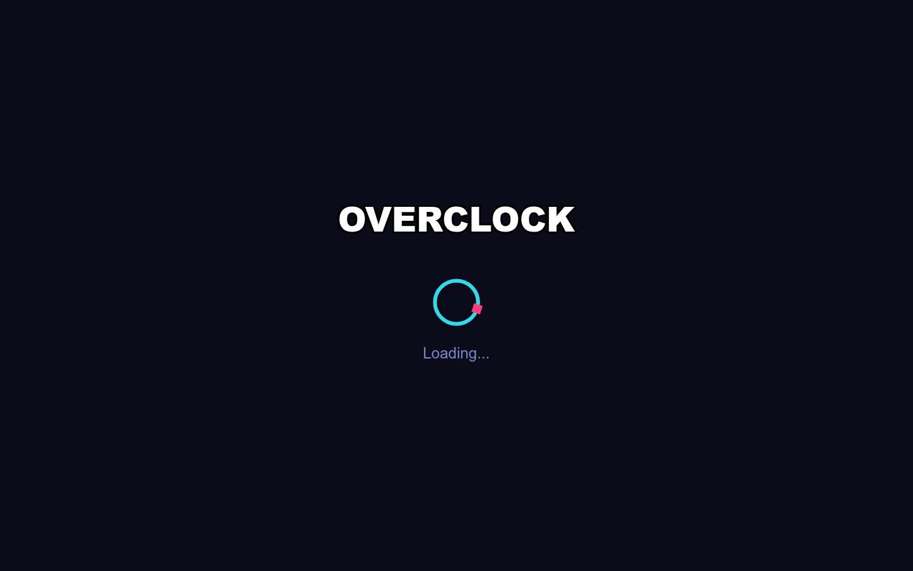

# Overclock

**Neon tower-climbing arcade game for YouTube Playables** — TypeScript, Phaser 3, Vite.

[**Play the live demo**](https://musn0o.github.io/overclock/)



## Projektüberblick (DE)

Overclock ist ein schnelles Arcade-Spiel, bei dem der Spieler einen Turm
hinaufklettert, Hindernissen ausweicht und combobasierte Höhenrekorde aufstellt.
Das Spiel wurde für die technischen und gestalterischen Anforderungen von
YouTube Playables entwickelt und läuft vollständig im Browser.

**Technischer Fokus:** Phaser-3-Szenen, TypeScript, prozedurale Grafik und
Audio, responsive Touch-/Tastatur-Steuerung sowie die Integration des
YouTube-Playables-SDK für Pause/Resume, Audio und Score-Reporting.

## Features

- Endless tower-climbing arcade loop
- Neon visual style with runtime-generated artwork
- Responsive touch, mouse and keyboard input
- Score reporting and pause/resume via the YouTube Playables SDK
- Self-contained production build, deployable to any static host

## Tech

- TypeScript
- Phaser 3
- Vite
- Web Audio API

## Run locally

```bash
npm install
npm run dev        # local development server
npm run build      # production bundle in dist/
npm run preview    # serve the production build
```

## Deploy

Deployed to GitHub Pages via `.github/workflows/deploy.yml`. Any static host
works — the production build is self-contained in `dist/`.

## Links

- **Live:** https://musn0o.github.io/overclock/
- **YouTube Playables integration:** `src/playables/YouTubePlayables.ts`
- **Roadmap:** [ROADMAP.md](ROADMAP.md)
